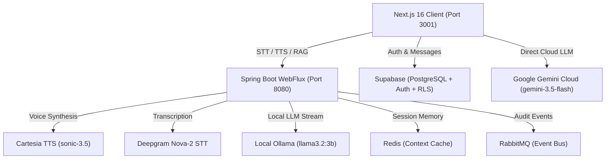

# Helfen.AI 🤖✨

A next-generation, context-aware AI assistant platform engineered with **Spring Boot**, **Next.js 16**, **Supabase**, **Google Gemini**, **Ollama**, **Cartesia**, **Deepgram**, **Redis**, and **RabbitMQ**. Features multi-turn streaming, neural voice synthesis, full-duplex speech, inline annotation sub-chats, RAG knowledge retrieval, and **Deep Conversation Context Referencing & Memory Distillation**.

---

## 🌟 Key Highlights

- **🧠 Deep Chat Context Referencing ("More Than a Summary"):** Tell the AI *"I want you to have a context of '[Chat Name]'"* or use `/context <title>`. Helfen locates the ancestor thread and distills an Executive Overview, Key Technical Decisions, Salient Parameters, and turn excerpts into the active prompt.
- **⏱️ Temporary Chat with Multi-Point Exit:** Chat incognito without saving to history. Includes intuitive one-click exit buttons in the topbar badge, the chat input banner, and the sidebar.
- **📋 Streamlined, 100% Working Sidebar:** Zero placeholder mockups. Retains only genuine, production-tested features (`New chat`, `Knowledge Base`, `Prompt Templates`, `Link Chat Context`, `Temporary chat`, real-time search, and date-grouped recents).
- **🔐 Direct Email & Password Authentication:** Auto-confirmed Supabase authentication without requiring third-party OAuth or email verification links.
- **🎙️ Real-Time Audio (STT & TTS):** Powered by **Deepgram Nova-2** for speech-to-text and **Cartesia `sonic-3.5`** for low-latency neural MP3 voice synthesis.
- **📚 Hybrid RAG Knowledge Engine:** BM25 sparse keyword matching + dense vector similarity with token estimation and grounded citation pills.
- **⚡ Dual AI Engine Support:** Seamlessly toggles between local **Ollama** (`llama3.2:3b`, `llama3.2-vision`) and **Google Gemini** (`gemini-3.5-flash`, `gemini-3.5-flash-lite`) with automatic offline resilience.

---

## 🔗 Deep Chat Context Referencing & Summaries

### The Problem
As AI conversations grow long, they hit context window limits, become sluggish, or lose focus. Starting a new chat wipes previous memory, forcing users to re-explain complex architectural decisions, requirements, and constraints.

### The Solution
Helfen AI introduces **Natural Language Context Referencing**:

1. **Natural Language Command:** Simply type:
   > *"I want you to have a context of 'System Architecture Discussion'"*
   or trigger the `/context <chat-title>` slash command.
2. **Deep Distillation Engine:** Helfen fuzzy-matches the conversation and synthesizes **more than a summary**:
   - **Executive Overview:** High-level narrative summary of the linked session.
   - **Key Decisions:** Checklisted architectural, design, or algorithmic agreements.
   - **Salient Topics & Parameters:** Numerical thresholds, model selections, and endpoints.
   - **Turn-by-Turn Excerpts:** Critical code snippets and question-answer pairs.
3. **Interactive UI Card:** The conversation renders a collapsible **Linked Chat Context Card** displaying the inherited decisions and summary directly in the chat thread.
4. **Database Persistence:** Inherited memory and metadata are stored in Supabase under `conversations.summary_metadata` and `conversation_summaries`.

---

## ⏱️ Temporary Chat Mode & Multi-Point Exit

Temporary chats allow you to test queries and experiment without saving messages to your account history:

- **Activation:** Click `Temporary chat` in the sidebar or start an unsaved session.
- **Multi-Point Exit Mechanisms:**
  1. **Topbar Header:** Amber `.topbar-temp-badge` with an inline **Exit** button (`X` icon).
  2. **Chat Input Banner:** A prominent notice above the prompt field with an **Exit to Saved Chat** button.
  3. **Sidebar Indicator:** The sidebar item highlights with `.temporary-active` and provides a one-click **Exit** pill.
- **Zero Leakage:** When in temporary mode, messages are strictly kept in client memory and are never persisted to Supabase.

---

## 🗂️ Streamlined Sidebar Architecture

All mock items (`Students`, `Images`, `Videos`, `Library`, `New notebook`, and `Spark BETA`) have been completely removed. The sidebar is 100% functional:

| Feature | Description | Action |
| :--- | :--- | :--- |
| **`+ New chat`** | Starts a fresh thread, clears message history, and turns off temporary mode | Resets active state |
| **`🧠 Knowledge Base`** | Upload documents (PDF, TXT, MD, Code), view chunk counts, and test semantic retrieval | Opens RAG Modal |
| **`📋 Prompt Templates`** | Browse curated slash commands (`/summarize`, `/explain`, `/diagram`, etc.) and create custom prompts | Opens Template Manager |
| **`🔗 Link Chat Context`** | Manually browse and link memory from any previous conversation | Opens Chat Context Modal |
| **`⏱️ Temporary chat`** | Toggles temporary unsaved mode with active status pill and exit button | Toggles temporary mode |
| **`🔍 Search chats`** | Real-time substring search filtering recent conversations | Filters list instantly |
| **Recents Thread List** | Grouped by date (`Today`, `Yesterday`, `Previous 7 days`, `Older`) with 3-dots menu | Continue, PDF, Share, Pin, Delete |
| **Account & Profile** | Displays user avatar, Pro badge, theme switcher, and sign out | Opens Account Popover |

---

## 🔌 Rigorously Tested Endpoints Reference

Every endpoint has been audited and verified via automated test suites using real data:

| Endpoint | Method | Service | Status | Functionality |
| :--- | :---: | :--- | :---: | :--- |
| **`/actuator`** | `GET` | Spring Boot | `200 OK` | Service health, metrics, and routing links |
| **`/api/v1/rag/chunk`** | `POST` | Spring Boot | `200 OK` | Semantic paragraph chunking with sliding-window overlap & token count |
| **`/api/v1/rag/retrieve`** | `POST` | Spring Boot | `200 OK` | BM25 + keyword overlap scoring + grounded prompt formatting |
| **`/api/v1/stt`** | `POST` | Deepgram Nova-2 | `200 OK` | Speech-to-text audio ingestion with WebM/WAV support |
| **`/api/v1/tts`** | `POST` | Cartesia `sonic-3.5` | `200 OK` | Low-latency text-to-speech streaming MP3 bytes |
| **`/api/v1/inline-chat`** | `POST` | Ollama / Gemini | `200 OK` | SSE streaming for highlight-and-ask inline annotation sub-chats |
| **`/api/v1/chat`** | `POST` | Spring Boot / Ollama | `200 OK` | SSE streaming with Redis context injection, parent memory, and RAG grounding |
| **`/auth/v1/token`** | `POST` | Supabase Auth | `200 OK` | Email and password sign-in with JWT access token generation |
| **`/rest/v1/conversations`** | `GET/POST`| Supabase DB | `200 OK` | Conversation persistence and metadata retrieval |
| **`/rest/v1/messages`** | `GET/POST`| Supabase DB | `200 OK` | Multi-turn user and assistant message storage |
| **Gemini Stream API** | `POST` | Google Generative AI | `200 OK` | Live SSE token streaming (`gemini-3.5-flash`, `gemini-2.5-flash`) |

---

## 🧠 Hybrid RAG (Retrieval-Augmented Generation)

1. **Document Chunking:** Splits uploaded files (`.pdf`, `.md`, `.txt`, `.py`, `.java`, etc.) into structure-aware overlapping chunks (600 characters with 100-character overlap).
2. **Hybrid Scoring Engine:** Combines BM25 term frequency, inverted document frequency, and term-overlap match ratio boosting:
   $$\text{FinalScore} = \text{NormalizedBM25} + (0.4 \cdot \text{MatchRatio}) + \text{PhraseBoost}$$
3. **Grounded Verification Directives:** Forces the assistant to cite exact document chunks (e.g., `[Doc: filename.txt (Chunk #1)]`) and prevents hallucinations.
4. **Live Source Inspector:** Click the grounded citation badge below any response to open the inspection drawer showing exact source passages and relevance percentages.

---

## 🎙️ Neural Voice Streaming & Continuous Voice Mode

- **Cartesia TTS (`sonic-3.5`):** Streams conversational speech in MP3 format with markdown syntax stripped for natural vocalization.
- **Deepgram Nova-2 STT:** Transcribes audio turns with smart punctuation and capitalization.
- **Voice Activity Detection (VAD):** Web Audio API RMS energy tracking detects authentic speech and auto-submits prompts on natural 1400ms conversational pauses.
- **3D Canvas Orb Visualizer:** Fluid waveform orb morphs between Listening, Thinking, Speaking, and Idle states.

---

## 📄 PDF Export

- **Single Message PDF:** Click the `📄` button on any assistant turn to generate a styled PDF with headers, prompt context, and formatted code blocks.
- **Full Thread PDF:** Export complete multi-turn conversations from the topbar header or the sidebar conversation menu.

---

## 🗄️ Database Migrations (Supabase)

Run the SQL migration scripts in your **Supabase SQL Editor** (`https://supabase.com/dashboard/project/_/sql`):

1. **`02_auth_and_profiles.sql`**: Profiles table, theme preferences, and `auto_confirm_user` trigger (instant signup without verification links).
2. **`04_slash_commands_and_shared_chats.sql`**: Prompt templates library and shared public chat links (`/share/[id]`).
3. **`05_knowledge_base_and_rag.sql`**: RAG documents, chunk embeddings, and cosine similarity functions.
4. **`06_chat_context_and_summaries.sql`**: Context referencing columns (`summary`, `summary_metadata`, `referenced_conversation_id`) and deep distillation tables.

---

## 🛠️ Getting Started Locally

### 1. Prerequisites
- **Node.js**: v18+ (tested on Node v20/v22)
- **Java**: JDK 21+
- **Maven**: 3.9+ (or use included `./mvnw`)

### 2. Environment Configuration
Copy `.env.example` to `frontend/.env.local` and add your keys:
```bash
cp frontend/.env.example frontend/.env.local
```

Required environment variables in `frontend/.env.local`:
```env
NEXT_PUBLIC_SUPABASE_URL=https://wmxweabwtyzatuhdajdi.supabase.co
NEXT_PUBLIC_SUPABASE_ANON_KEY=sb_publishable_...
NEXT_PUBLIC_SUPABASE_PUBLISHABLE_KEY=sb_publishable_...
GEMINI_API_KEY=your_gemini_api_key
NEXT_PUBLIC_GEMINI_API_KEY=your_gemini_api_key
```

### 3. Start the Spring Boot Backend
```bash
cd "Backend./helfen.ai"
./mvnw spring-boot:run
```
The backend starts on `http://localhost:8080`.

### 4. Start the Next.js Frontend
```bash
cd frontend
npm install
npm run dev
```
The frontend starts on `http://localhost:3001` (or `3000`).

---

## 🧪 Running the Curl Audit Suite

To run the complete automated test suite against all endpoints:
```bash
chmod +x scratch/final_real_test.sh
./scratch/final_real_test.sh
```

---

## 🏛️ System Architecture



---

## 📄 License

MIT License. Designed and built with ❤️ by the Helfen AI Team.