# Helfen ⚡

[](https://nextjs.org/)
[](https://react.dev/)
[](https://spring.io/projects/spring-boot)
[](https://www.oracle.com/java/)
[](https://www.typescriptlang.org/)
[](https://supabase.com/)
[](https://tailwindcss.com/)
[](https://opensource.org/licenses/MIT)

**Helfen** is an enterprise-grade, context-aware artificial intelligence platform engineered for multi-session continuity, grounded knowledge retrieval, neural voice interaction, and collaborative intelligence.

Built on an asynchronous micro-service architecture powered by **Spring Boot WebFlux** and **Next.js 16 (App Router & Turbopack)**, Helfen seamlessly bridges cloud intelligence (**Google Gemini 2.5 / 3.5**) and private on-premise execution (**Local Ollama Llama 3.2**), backed by **Deepgram Nova-2** speech recognition, **Cartesia Sonic-3.5** neural speech synthesis, **Supabase PostgreSQL** with Row-Level Security, **Redis**, and **RabbitMQ**.

---

## 📑 Table of Contents

- [🏛️ System Architecture](#️-system-architecture)
- [✨ Key Platform Capabilities](#-key-platform-capabilities)
  - [1. Deep Conversation Context Referencing & Memory Distillation](#1-deep-conversation-context-referencing--memory-distillation)
  - [2. Hybrid Retrieval-Augmented Generation (RAG)](#2-hybrid-retrieval-augmented-generation-rag)
  - [3. Full-Duplex Neural Voice & 3D Waveform Orb](#3-full-duplex-neural-voice--3d-waveform-orb)
  - [4. Dual-Engine LLM Inference (Gemini Cloud + Local Ollama)](#4-dual-engine-llm-inference-gemini-cloud--local-ollama)
  - [5. Interactive Highlight-and-Ask Inline Annotation Sub-Chats](#5-interactive-highlight-and-ask-inline-annotation-sub-chats)
  - [6. Ephemeral Temporary Chat with Multi-Point Exit](#6-ephemeral-temporary-chat-with-multi-point-exit)
  - [7. Prompt Template Manager & Slash Commands Engine](#7-prompt-template-manager--slash-commands-engine)
  - [8. Single-Turn & Multi-Turn PDF Exporter](#8-single-turn--multi-turn-pdf-exporter)
  - [9. Public Chat Sharing & Interactive Forking (`/share/[id]`)](#9-public-chat-sharing--interactive-forking-shareid)
  - [10. State-of-the-Art Adaptive Micro-Interactions](#10-state-of-the-art-adaptive-micro-interactions)
- [🔌 Audited Production Endpoints Reference](#-audited-production-endpoints-reference)
- [📂 Repository File Tree](#-repository-file-tree)
- [🗄️ Database Schema & Supabase Migrations](#️-database-schema--supabase-migrations)
- [🚀 Quickstart & Developer Installation](#-quickstart--developer-installation)
  - [Prerequisites](#prerequisites)
  - [Environment Configuration](#environment-configuration)
  - [Starting the Spring Boot Backend](#starting-the-spring-boot-backend)
  - [Starting the Next.js Frontend](#starting-the-nextjs-frontend)
- [🧪 Automated Verification & Smoke Testing](#-automated-verification--smoke-testing)
- [🛡️ Security Architecture & Privacy Isolation](#️-security-architecture--privacy-isolation)
- [📄 License & Authors](#-license--authors)

---

## 🏛️ System Architecture

Helfen employs an asynchronous reactive pipeline that decouples real-time audio/LLM streams from persistent relational state:

```mermaid
flowchart TD
    subgraph Client ["Client Presentation Tier (Next.js 16 + React 19)"]
        UI["Helfen Dynamic UI"]
        Zustand["Zustand Persistent Store"]
        AudioEng["Web Audio VAD & RMS Engine"]
        Toaster["Viewport-Aware Dynamic Toaster"]
    end

    subgraph Gateway ["Reactive Backend Tier (Spring Boot WebFlux)"]
        ChatCtrl["ChatController (SSE Streams)"]
        RAGCtrl["RagController (BM25 + Tokenizer)"]
        VoiceCtrl["SttController & TtsController"]
        RedisSvc["Redis Context Cache"]
        QueueSvc["RabbitMQ Audit Bus"]
    end

    subgraph Data ["Persistence & Security Tier (Supabase)"]
        Postgres[("Supabase PostgreSQL DB")]
        Auth["Supabase Auth (Direct Email/Password)"]
        RLS["Row-Level Security (RLS) Policies"]
        Realtime["PostgreSQL Change Streams"]
    end

    subgraph AI ["Neural Inference & Voice Tier"]
        Gemini["Google Gemini Cloud API"]
        Ollama["Local Ollama Service (Llama 3.2 3B / Vision)"]
        Deepgram["Deepgram Nova-2 (Real-Time STT)"]
        Cartesia["Cartesia Sonic-3.5 (Neural TTS)"]
    end

    UI -->|"User Prompts & Auth"| Gateway
    UI -->|"Direct DB Queries & Subscriptions"| Postgres
    UI -->|"Session State"| Zustand
    AudioEng -->|"PCM WebM Audio Turns"| VoiceCtrl
    ChatCtrl -->|"Inference Request"| Gemini
    ChatCtrl -->|"Local Offline Fallback"| Ollama
    VoiceCtrl -->|"Binary Transcription Stream"| Deepgram
    VoiceCtrl -->|"Low-Latency MP3 Synthesis"| Cartesia
    RAGCtrl -->|"Vector Search & Semantic Match"| Postgres
    ChatCtrl -->|"Fast Context Cache"| RedisSvc
    ChatCtrl -->|"Telemetry"| QueueSvc
```



---

## ✨ Key Platform Capabilities

### 1. Deep Conversation Context Referencing & Memory Distillation
When AI sessions become long, they hit context window limits, degrade in accuracy, and become costly. Starting a new chat typically erases all prior context.

Helfen solves this through **Natural Language Memory Distillation**:
- **Zero-Friction Triggering**: Type *"I want you to have a context of '[Chat Name]'"* in chat or execute `/context <chat-title>`.
- **Intelligent Semantic Fuzzy-Matching**: Helfen resolves ancestor chat records using token-distance indexing.
- **Deep Distillation Model**: Rather than an unstructured summary, Helfen compiles four structured metadata tiers:
  1. **Executive Overview**: High-level narrative of core objectives and outcomes.
  2. **Key Technical Decisions**: Checklisted architecture choices, database selections, and algorithmic agreements.
  3. **Salient Parameters & Constraints**: Numerical thresholds, endpoints, and credentials constraints.
  4. **Turn-by-Turn Excerpts**: Crucial code snippets and problem-solving dialogues.
- **Interactive In-Thread Context Card**: Renders an expandable visual card within the conversation thread showing inherited context metrics and quick-unlink actions.
- **Persistent Ancestor Linking**: Stored natively in Supabase under `conversations.summary_metadata` and `conversation_summaries`.

### 2. Hybrid Retrieval-Augmented Generation (RAG)
Helfen implements a high-precision document search and retrieval engine:
- **Structure-Aware Sliding Window Chunking**: Chunks text, code, markdown, and PDFs into 600-character blocks with a 100-character sliding overlap to preserve sentence boundaries.
- **Hybrid Scoring Formula**:
  $$\text{FinalScore} = \text{NormalizedBM25} + (0.4 \cdot \text{KeywordMatchRatio}) + \text{PhraseBoost}$$
- **Strict Grounding Directives**: Enforces citation markers (e.g. `[Doc: filename.pdf (Chunk #2)]`) preventing hallucinations.
- **Interactive Source Inspector**: Clicking any grounded citation badge opens a slide-over drawer displaying the source text, document metadata, and match confidence scores.

### 3. Full-Duplex Neural Voice & 3D Waveform Orb
- **Deepgram Nova-2 Audio Transcription**: Ingests raw voice inputs with automated punctuation and punctuation formatting.
- **Cartesia Sonic-3.5 Synthesis**: Ultra-low latency voice streaming generating 44.1kHz MP3 audio with markdown stripping for natural vocal cadence.
- **Voice Activity Detection (VAD)**: Real-time Web Audio API RMS energy tracking automatically submits questions after 1400ms of natural silence.
- **3D Canvas Fluid Waveform Visualizer**: Smooth morphing orb reacting in real-time to four distinct conversational states: `Listening`, `Thinking`, `Speaking`, and `Idle`.

### 4. Dual-Engine LLM Inference (Gemini Cloud + Local Ollama)
- **Google Gemini API**: Native Server-Sent Event (SSE) streaming with `gemini-3.5-flash`, `gemini-2.5-flash`, and `gemini-3.5-flash-lite`.
- **Local Ollama Cluster**: Self-hosted, private offline inference running `llama3.2:3b` and `llama3.2-vision`.
- **Automatic Fallback Resilience**: Seamless fallback to Ollama if cloud connectivity is interrupted.

### 5. Interactive Highlight-and-Ask Inline Annotation Sub-Chats
- Highlight any code block, sentence, or technical phrase inside an assistant reply.
- An interactive floating pill (`Ask Helfen inline`) pops up, allowing users to ask micro-questions on specific passages.
- Creates persistent threaded annotations saved in Supabase (`inline_annotations` & `inline_messages`).

### 6. Ephemeral Temporary Chat with Multi-Point Exit
- **Private Incognito Sessions**: Conduct tests or sensitive queries without leaving traces in account history.
- **Multi-Point Exit Triggers**:
  - **Topbar Header**: Amber `.topbar-temp-badge` with an immediate `X` exit button.
  - **Prompt Warning Banner**: Floating notice above input field with `Exit to Saved Chat`.
  - **Sidebar Active Item**: Highlights with `.temporary-active` and provides a quick-exit pill.
- **Guaranteed Zero Persistence**: Bypasses Supabase persistence, keeping all messages strictly in client memory.

### 7. Prompt Template Manager & Slash Commands Engine
- Access built-in curated slash commands (`/explain`, `/diagram`, `/summarize`, `/refactor`, `/tests`, `/context`).
- Custom Template Studio: Create, edit, and categorize custom parameterized prompt templates stored directly in Supabase.

### 8. Single-Turn & Multi-Turn PDF Exporter
- High-fidelity PDF generation using client-side canvas rendering.
- **Turn-Level Export**: Click the `📄` button on any individual assistant message to download a clean, formatted technical brief.
- **Thread-Level Export**: Export entire multi-turn conversations complete with timestamps, model badges, and syntax-highlighted code.

### 9. Public Chat Sharing & Interactive Forking (`/share/[id]`)
- Generate secure public URLs for any conversation.
- **One-Click Forking**: Any visitor viewing a shared link can fork the thread into their private workspace to continue the dialogue seamlessly.

### 10. State-of-the-Art Adaptive Micro-Interactions
- **Directional Sidebar Arrow Toggle**:
  - Displays `<` (`ChevronLeft`) when the sidebar is open to collapse it.
  - Displays `>` (`ChevronRight`) beside the Helfen logo when the sidebar is collapsed to expand it.
- **Viewport-Aware Dynamic Notifications**:
  - Centered over the main workspace area when the left sidebar is open.
  - Glides smoothly (`transition: left 0.25s`) to the dead center of the screen when the sidebar is collapsed.
- **3-Line Auto-Expanding Prompt Bar**:
  - Expands gracefully as you type up to 3 lines (72px max-height).
  - Automatically enables a custom internal scrollbar on line 4+, keeping the interface clean and compact.
- **Fixed-Size Modal Architecture**:
  - Modal boxes (Context Linking, Knowledge Base, Prompt Templates) maintain fixed dimensions and never resize unexpectedly.
  - The Conversation Continuation modal displays at most 3 chat cards; any additional chats scroll cleanly beneath the search bar.

---

## 🔌 Audited Production Endpoints Reference

| Endpoint | Method | Service / Handler | Description | Status |
| :--- | :---: | :--- | :--- | :---: |
| **`/api/v1/chat`** | `POST` | Spring Boot / Ollama | Real-time SSE token stream with context injection | `200 OK` |
| **`/api/v1/inline-chat`** | `POST` | Spring Boot / Ollama | Highlighted text sub-chat streaming | `200 OK` |
| **`/api/v1/rag/chunk`** | `POST` | Spring Boot RAG Engine | Sliding-window semantic document chunking | `200 OK` |
| **`/api/v1/rag/retrieve`** | `POST` | Spring Boot RAG Engine | BM25 sparse matching + vector similarity scoring | `200 OK` |
| **`/api/v1/stt`** | `POST` | Deepgram Nova-2 | Binary audio turn speech-to-text transcription | `200 OK` |
| **`/api/v1/tts`** | `POST` | Cartesia `sonic-3.5` | Neural text-to-speech audio streaming (MP3) | `200 OK` |
| **`/actuator/health`** | `GET` | Spring Boot Actuator | Service health, memory, and dependency telemetry | `200 OK` |
| **`/auth/v1/token`** | `POST` | Supabase Auth API | JWT authentication with auto-confirmed profiles | `200 OK` |
| **`/rest/v1/conversations`** | `GET/POST`| Supabase REST DB | Conversation metadata and summary persistence | `200 OK` |
| **`/rest/v1/messages`** | `GET/POST`| Supabase REST DB | Full multi-turn message thread retrieval & insertion | `200 OK` |
| **`/rest/v1/shared_chats`** | `GET/POST`| Supabase REST DB | Public read-only snapshots and fork tracking | `200 OK` |

---

## 📂 Repository File Tree

```text
helfen-ai/
├── Backend./helfen.ai/                  # Spring Boot 4.1.1 WebFlux Backend
│   ├── pom.xml                          # Maven build configuration (Java 21)
│   ├── mvnw                             # Maven wrapper executable
│   └── src/main/java/com/likhith/helfen/ai/
│       ├── Application.java             # Main application entry point
│       ├── config/                      # WebClient, Security & CORS configs
│       ├── controller/                  # Chat, RAG, STT, and TTS controllers
│       ├── dto/                         # Request & Response Data Transfer Objects
│       └── service/                     # Cartesia, Deepgram, Ollama, RAG, Redis, RabbitMQ
│
├── frontend/                            # Next.js 16.4.0 Frontend Application
│   ├── package.json                     # Dependencies (React 19, Zustand, Lucide, Tailwind v4)
│   ├── next.config.ts                   # Turbopack & Image optimization settings
│   ├── src/
│   │   ├── app/
│   │   │   ├── layout.tsx               # Root layout with Viewport-Aware Toaster & Providers
│   │   │   ├── page.tsx                 # Core Helfen assistant workspace
│   │   │   ├── globals.css              # Custom design system, Aurora gradients & animations
│   │   │   └── share/[id]/page.tsx      # Public conversation sharing & forking viewer
│   │   ├── components/                  # Modular UI component architecture
│   │   │   ├── Sidebar.tsx              # Directional chevron sidebar & thread organizer
│   │   │   ├── ChatInput.tsx            # 3-line auto-expanding prompt bar with VAD
│   │   │   ├── ChatContextModal.tsx     # Conversation continuation & memory linker
│   │   │   ├── KnowledgeBaseModal.tsx   # Hybrid RAG document chunking studio
│   │   │   ├── MessageList.tsx          # Multi-turn dialogue with inline highlight tools
│   │   │   ├── VoiceModal.tsx           # Full-duplex voice dialog with 3D waveform orb
│   │   │   ├── AppToaster.tsx           # Dynamic viewport-aware notification manager
│   │   │   └── AuthModal.tsx            # Direct email/password Supabase authentication
│   │   ├── lib/                         # Client services (Gemini, Supabase, PDF, Audio)
│   │   └── store/                       # Zustand persistent state slices (`appStore.ts`)
│   └── public/                          # Static assets and webfonts
│
├── supabase_migrations/                 # Production PostgreSQL Migration Scripts
│   ├── 01_add_continuation_chats.sql
│   ├── 02_auth_and_profiles.sql
│   ├── 03_add_message_attachments.sql
│   ├── 04_slash_commands_and_shared_chats.sql
│   ├── 05_knowledge_base_and_rag.sql
│   ├── 06_chat_context_and_summaries.sql
│   └── 07_add_notes_and_highlights.sql
│
├── supabase_schema.sql                  # Comprehensive baseline schema definition
└── README.md                            # World-class technical documentation
```

---

## 🗄️ Database Schema & Supabase Migrations

Execute the migration scripts located in `supabase_migrations/` via your **Supabase Dashboard SQL Editor**:

1. **`01_add_continuation_chats.sql`**: Configures multi-session thread lineage and parent conversation tracking.
2. **`02_auth_and_profiles.sql`**: Generates user profiles table, theme preferences, and an `auto_confirm_user` trigger that eliminates mandatory email verification links for instant signups.
3. **`03_add_message_attachments.sql`**: Adds JSONB attachment metadata arrays to messages for multi-modal context.
4. **`04_slash_commands_and_shared_chats.sql`**: Sets up custom prompt templates and public shared conversations (`shared_chats`).
5. **`05_knowledge_base_and_rag.sql`**: Provisions RAG document catalogs, vector chunk tables, and similarity search stored procedures.
6. **`06_chat_context_and_summaries.sql`**: Deploys deep distillation columns (`summary`, `summary_metadata`) and distillation history tables.
7. **`07_add_notes_and_highlights.sql`**: Creates tables for highlight-and-ask inline micro-chats (`inline_annotations`, `inline_messages`).

---

## 🚀 Quickstart & Developer Installation

### Prerequisites
- **Node.js**: v20.x or v22.x LTS
- **Java Development Kit (JDK)**: Version 21 or higher
- **Ollama**: (Optional for local AI) Running on `http://localhost:11434`
- **Supabase Account**: Managed or local Supabase instance

### Environment Configuration

Create `frontend/.env.local` using the template below:

```env
# Supabase Configuration
NEXT_PUBLIC_SUPABASE_URL=https://your-project-id.supabase.co
NEXT_PUBLIC_SUPABASE_ANON_KEY=your_supabase_anon_key
NEXT_PUBLIC_SUPABASE_PUBLISHABLE_KEY=your_supabase_publishable_key

# Google Gemini API
GEMINI_API_KEY=your_google_gemini_api_key
NEXT_PUBLIC_GEMINI_API_KEY=your_google_gemini_api_key

# Spring Boot Backend Gateway
NEXT_PUBLIC_BACKEND_URL=http://localhost:8080
```

Configure backend API keys in `Backend./helfen.ai/src/main/resources/application.properties` (or via environment variables):

```properties
deepgram.api.key=your_deepgram_api_key
cartesia.api.key=your_cartesia_api_key
ollama.base.url=http://localhost:11434
```

### Starting the Spring Boot Backend

```bash
cd "Backend./helfen.ai"
./mvnw clean spring-boot:run
```
*The Spring Boot reactive service starts on port `8080`.*

### Starting the Next.js Frontend

```bash
cd frontend
npm install
npm run dev
```
*The Next.js client starts on `http://localhost:3000`.*

---

## 🧪 Automated Verification & Smoke Testing

Verify the health and responsiveness of all services via terminal cURL commands:

```bash
# 1. Verify Spring Boot Actuator Telemetry
curl -s http://localhost:8080/actuator/health | jq .

# 2. Test Document Chunking Endpoint
curl -s -X POST http://localhost:8080/api/v1/rag/chunk \
  -H "Content-Type: application/json" \
  -d '{"text": "Helfen is an AI assistant engineered with Next.js 16 and Spring Boot."}' | jq .

# 3. Test Speech Synthesis (TTS)
curl -s -X POST http://localhost:8080/api/v1/tts \
  -H "Content-Type: application/json" \
  -d '{"text": "Hello from Helfen"}' --output /tmp/test_voice.mp3
file /tmp/test_voice.mp3

# 4. Verify Next.js Client Health
curl -sI http://localhost:3000 | head -n 5
```

---

## 🛡️ Security Architecture & Privacy Isolation

- **Row-Level Security (RLS)**: Enforced across all Supabase PostgreSQL tables; users can strictly only read and mutate their own conversations, notes, and uploaded documents.
- **Temporary Chat Memory Sandbox**: Ephemeral sessions completely bypass the database layer. Prompts, completions, and transient keys remain strictly in volatile browser RAM.
- **Clean Git Boundaries**: Proprietary brand assets, private API credentials, and internal media attachments are strictly enforced in `.gitignore`.

---

## 📄 License & Authors

Distributed under the **MIT License**. See `LICENSE` for details.

Engineered with ❤️ by **Likhith** and the Helfen Core Team.
